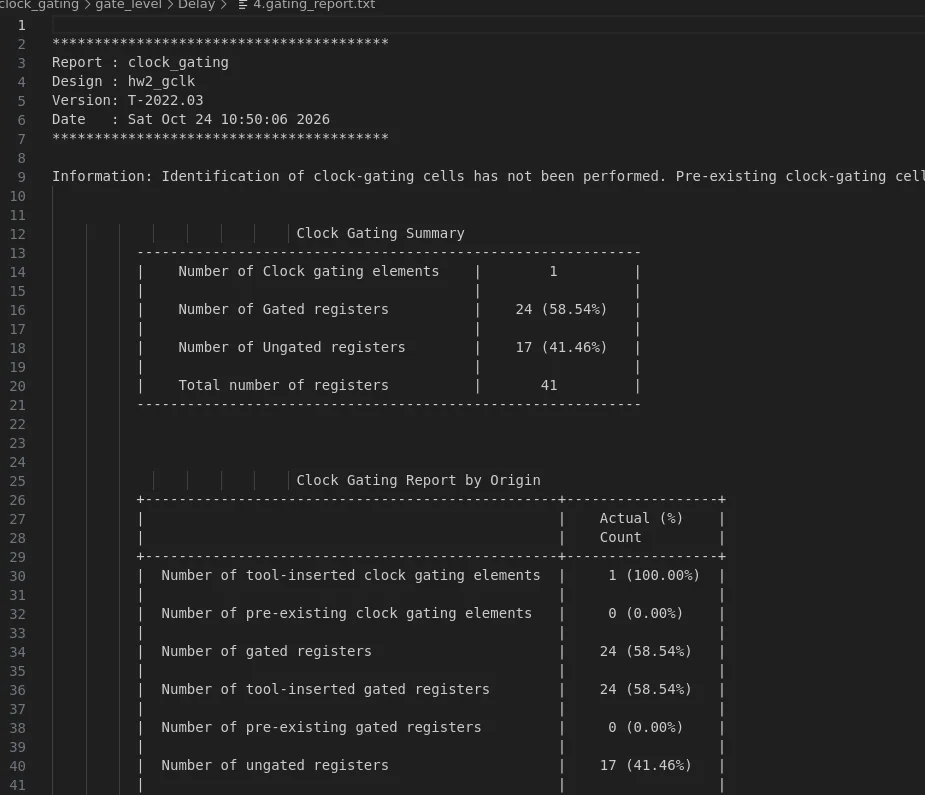
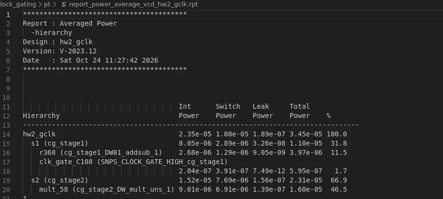

# Clock Gating 與功耗

> 以 HW2 實驗說明：透過降低 Register 無效切換，觀察數位電路的切換功率變化。

## 01 / Clock Gating 在做什麼

動態功耗受切換活動、電容、電壓與頻率影響。當某些 Register 暫時不需要更新，可以透過 **Integrated Clock Gating（ICG）** 降低該部分 Clock Network 與暫存器的切換活動。

## 02 / HW2 的控制方式

在 HW2 的 Clock-Gated 設計中，`c=0` 時關閉部分 Stage 1 Register 的 gated clock，使 `sum_q`、`c_q` 保持原值；另有控制狀態負責讓第二級輸出正確的 0。`c≠0` 時，相關 Stage 繼續更新。

## 03 / 功耗量測

報告中的 PrimeTime VCD Power 紀錄：

| 架構 | Total Power |
| --- | --- |
| Pipelined | 約 4.35×10⁻⁵ W |
| Clock-Gated | 約 3.45×10⁻⁵ W |

在 **200 組 Pattern（`c=0`、`c≠0` 各 100 組）** 的測試條件下，功耗約減少 **20.7%**。

## 04 / 分析時注意的事情

不同的輸入分布與實際 Clock Activity，會讓節能幅度改變。Clock Gating 也會增加 ICG 與控制資源，因此要與 Area、Timing、功能驗證一起評估。這次 DC 的三個架構結果也反映 Clock-Gated 的面積相對較大。

## 05 / 我的重點整理

Clock Gating 的價值是減少**不必要的切換**；效果需要搭配實際 VCD Activity 與相同測試條件判斷。HW2 也提醒我，面積、延遲與功耗通常需要一起權衡。

*資料來源：本人 HDL HW2 報告。*
