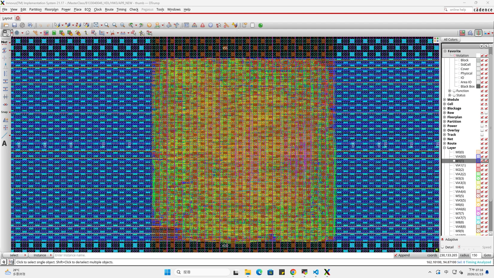

# 從 RTL 到 LVS：EDA Flow

> 以 HW3 的 Pipelined THUMB CPU 作業為例，整理數位 IC 設計流程。這是一篇依個人實驗經驗撰寫的學習筆記。

## 01 / 流程總覽

**RTL Design → Functional Simulation → Logic Synthesis → Timing / Power Analysis → Placement & Routing → DRC / LVS**

每個階段的重點不同：前半段確保**功能與邏輯**，後半段處理**實體布局、時序、製程規則和電路一致性**。

## 02 / RTL 與 Simulation

Verilog RTL 描述暫存器、運算邏輯與訊號如何在 Clock Edge 間更新。使用 Testbench 驗證邊界條件、Reset 與輸入輸出時序。在 HW3 中，四個 Pipeline Stage 依序是 IF、ID、EX、WB。

## 03 / Synthesis（DC）

Design Compiler 將 RTL 與時序約束映射成 Standard Cells，產生 Gate-Level Netlist。需要查看 **Area、Critical Path、Slack**，並比較不同約束下的取捨。

## 04 / Timing 與 Power（PT）

PrimeTime 讀入網表、Timing Constraint 與活動資訊分析路徑及功耗。DC 的估計功率與 PT 根據 VCD 活動推算的數據，因分析條件不同而可能不同。

## 05 / APR（Innovus）

常見步驟包含 **Floorplan、Power Planning、Placement、CTS、Routing、Optimization**。Placement 決定 Cell 位置；CTS 建立時脈分配；Routing 完成金屬連線；後續檢查 Setup / Hold Timing。

## 06 / DRC 與 LVS

**DRC（Design Rule Check）** 驗證實體布局是否符合相關製程規則；**LVS（Layout Versus Schematic）** 比較 Layout 抽取電路與來源 Netlist 的一致性。HW3 最終紀錄是 DRC **0 Violations**、LVS **CORRECT**。

## 07 / 這次實際學到什麼

EDA Flow 最重要的是每個階段留下可以檢查的結果。模擬檢查功能、Timing Report 檢查時序、DRC 檢查實體設計規則、LVS 檢查連線與元件對應。當驗證不通過時，回到該階段的報告定位原因。

*資料來源：本人 HDL HW3 報告與執行紀錄；部分定義為個人整理。*
