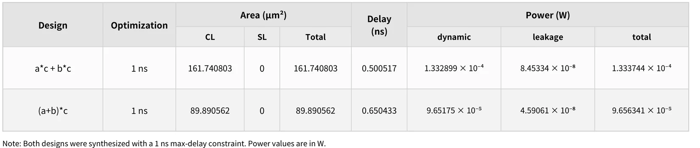
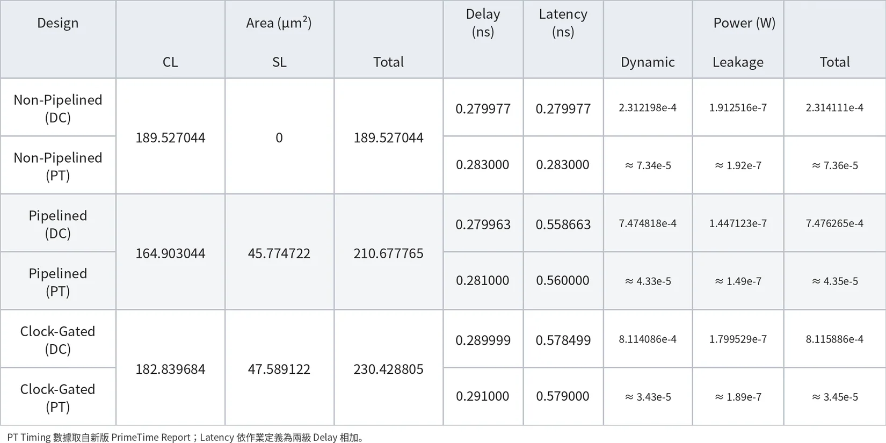
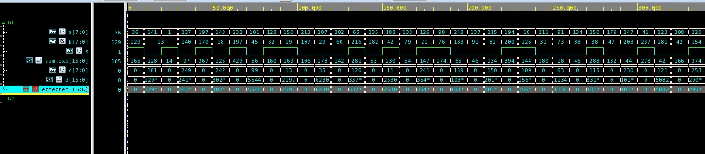
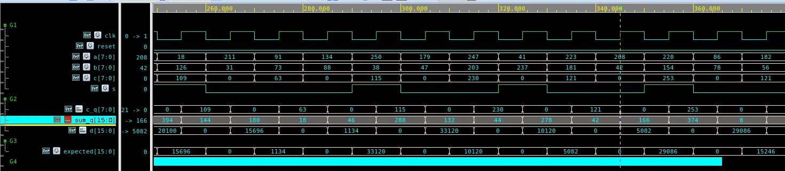
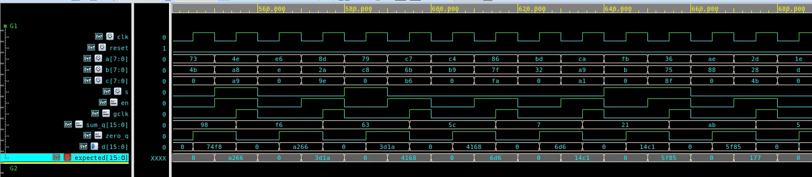
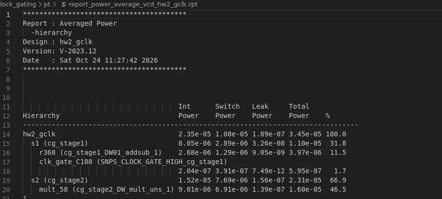
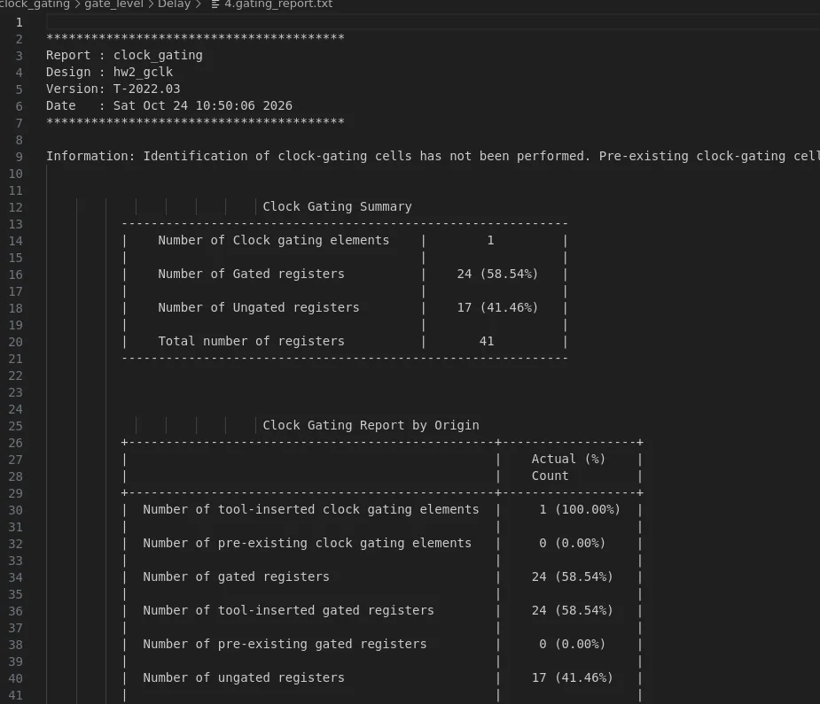
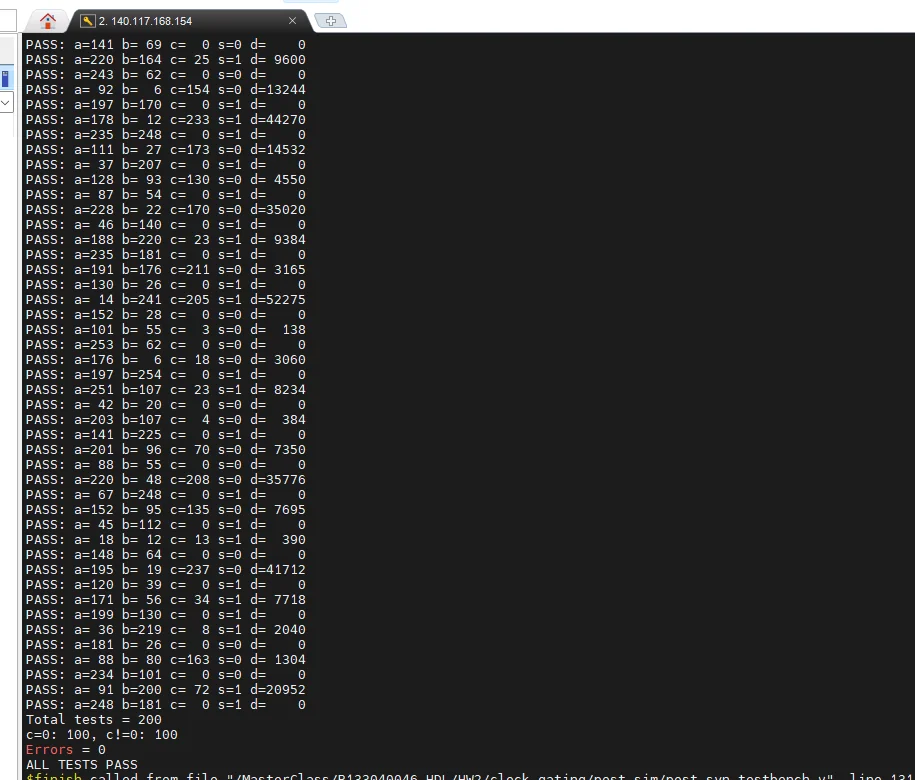
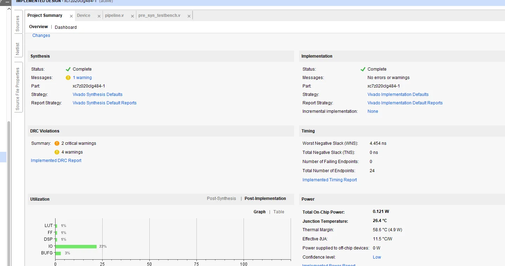

# HW2：Pipeline & Clock Gating

> 實驗主題：同一個算術運算，透過不同 Verilog 寫法、Pipeline 與 Clock Gating，比較面積、延遲、功耗與模擬結果。整理依據為本人《HW2_Report_PPA_Final_20261024》作業報告。

## 01 / 作業目標

這次實驗先比較兩種等價的乘加運算寫法，再比較共用加減法器的合成效果，最後實作 **Non-Pipelined、Pipelined、Clock-Gated** 三個版本。使用 VCS 進行 RTL / Gate-Level 模擬，透過 Design Compiler（DC）取得 PPA，再使用 PrimeTime（PT）及 Vivado 查看實際活動功率與 FPGA Implementation。

**核心問題**：RTL 是硬體的描述方式，合成器會依運算結構、共享情形及時序約束產生不同的電路。

## 02 / RTL 寫法如何影響 PPA

兩個算術式子 `a*c + b*c` 與 `(a+b)*c` 數學上等價，但對應的運算結構不同。作業報告中的結果顯示，共因式版本使 Area 從 **161.740803 μm²** 降到 **89.890562 μm²**（約 **44.4%**），但 Delay 從 **0.500517 ns** 增加到 **0.650433 ns**（約 **30.0%**）。

我從這個實驗理解到，**硬體資源共享通常有助於縮小面積，但運算依賴也可能增加 Critical Path**。同樣在加減法器比較中，`add_sub_2`、`add_sub_3` 的 Area 為 **13.633920 μm²**，比 `add_sub_1` 的 **18.455040 μm²** 少約 **26.1%**。

## 03 / 三種架構對照

| 架構 | DC Area (μm²) | DC Critical Delay (ns) | 特徵 |
| --- | ---: | ---: | --- |
| Non-Pipelined | 189.527044 | 約 0.280 | 組合邏輯，不經 Pipeline Register |
| Pipelined | 210.677765 | 約 0.280 | 兩級運算，使用 Stage Register |
| Clock-Gated | 230.428805 | 約 0.290 | Pipeline 加上時脈活動控制 |

上述是這次報告保留的 DC 結果。面積隨 Pipeline Register 與 Clock-Gating 邏輯增加；時序與功耗則要搭配測試條件及工具報告解讀。

## 04 / 波形與資料對齊

**Non-Pipelined** 在輸入更新後，組合邏輯輸出會依電路延遲改變；**Pipelined** 第一級先記錄 `a±b` 與 `c`，第二級在後續 Clock Edge 完成乘法，因此 Testbench 必須把 `d` 與正確的歷史輸入 `expected` 對齊。

**Clock-Gated** 版本在 `c=0` 時停止部分 Stage 1 Register 的無效切換，同時保留正確的零值處理。

## 05 / Clock Gating 省電結果

PrimeTime 使用兩組架構相同測試活動的 VCD 功率資訊。作業報告記錄 **Pipelined 約 4.35×10⁻⁵ W、Clock-Gated 約 3.45×10⁻⁵ W**，在這次測試活動下約降低 **20.7%**。測試條件為 **200 組 Pattern（`c=0` 與 `c≠0` 各 100 組）**。

Clock-Gating 報告顯示 1 個 ICG、24／41 個 Gated Registers（58.54%）。功耗節省量會隨資料分布、Clock Activity 與工具設定改變；因此不能把這個百分比直接當作所有應用都能達成的結果。

## 06 / 自動驗證與 FPGA

作業使用 **200 組輸入**進行驗證，並保留 VCS 的 PASS 紀錄；Vivado 部分則進行 Behavioral / Post-Implementation Functional Simulation。這次報告記錄的 Vivado XDC Clock Period 為 **10 ns**、Setup WNS **+4.454 ns**。

## 07 / 實驗心得

這次最有價值的收穫，是能從同一個功能的不同 RTL 寫法看見 **Area / Delay Trade-off**；Pipeline 也讓我理解資料必須依時脈分級處理，而 Clock Gating 的效果需要搭配 VCD Activity 才能量化。往後閱讀 PPA 時，我會一起檢查合成條件、Stage Timing、功率工具與測試輸入。

*資料來源：本人 HDL HW2 作業報告，整理日期 2026-10-24。截圖為本人作業成果。*
