# HW3：Pipelined THUMB CPU

> 實驗主題：完成四級 Pipeline THUMB CPU，從 RTL / Gate-Level Simulation，延伸至 Synthesis、STA、APR、DRC 與 LVS。整理依據為本人《HDL HW3 Pipelined THUMB CPU》作業報告初稿。

## 01 / 四級 Pipeline 架構

這次將 THUMB CPU 劃分成 **IF（Instruction Fetch）、ID（Instruction Decode）、EX（Execute）、WB（Write Back）** 四個 Pipeline Stage，並各自封裝成獨立模組，方便觀察各 Stage 的 Critical Path。

| Stage | 模組 | 主要工作 |
| --- | --- | --- |
| IF | `s1 / thumb_if` | 取指令 |
| ID | `s2 / thumb_id` | 解碼指令 |
| EX | `s3 / thumb_ex` | 執行運算 |
| WB | `s4 / thumb_wb` | 寫回結果 |

## 02 / RTL 與 Gate-Level Simulation

使用既有 Testbench 檢查時脈、重置、記憶體存取及 Stage 間資料傳遞。驗證目標包含指定的資料位址 **`0x100`** 與資料值 **`0x24`**。除了比較 RTL 與 Gate-Level 波形，還需要確認 Testbench 最後的判定訊息。

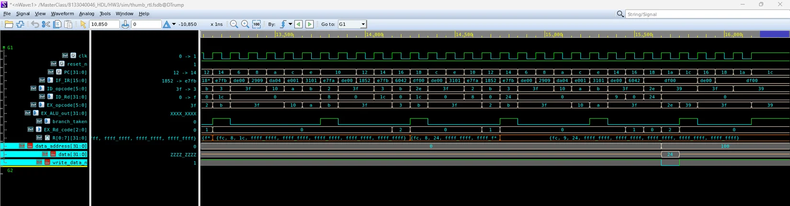

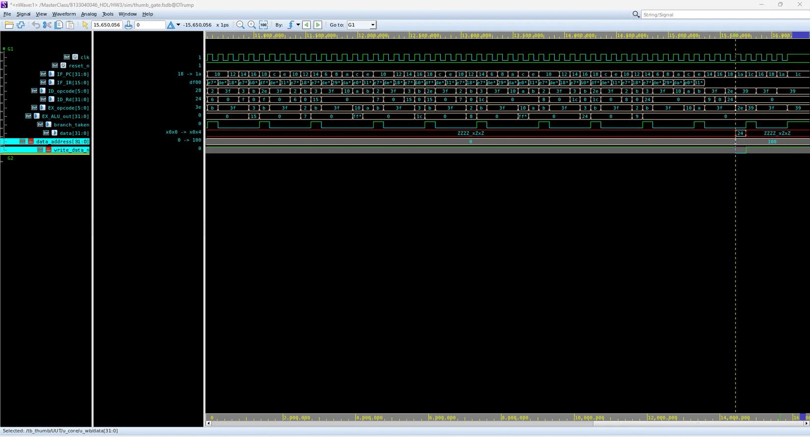

## 03 / Synthesis 與 Timing Analysis

依照老師要求，使用 **Area-opt、Delay-opt、In-between** 三種條件比較 DC 合成結果，再以 PrimeTime 分析功耗。報告中保存的早期比較資料顯示，Delay-opt 的面積較 Area-opt 大，但 Critical Delay 較短，反映硬體資源與速度之間的取捨。

**資料狀態提醒**：原始 HW3 報告已註明，三組 DC/PT PPA 表格與部分截圖為先前執行的資料，尚需和最終 RTL、Gate Netlist 版本核對。這裡將其保留為實驗紀錄，不當作最後同版量測結論。

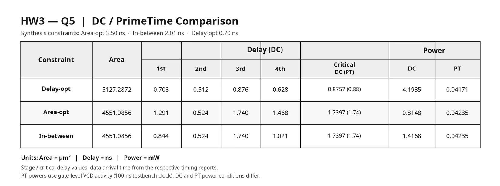

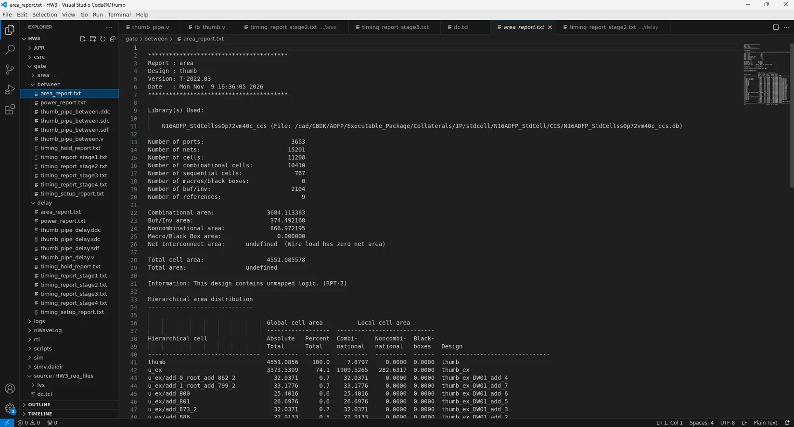

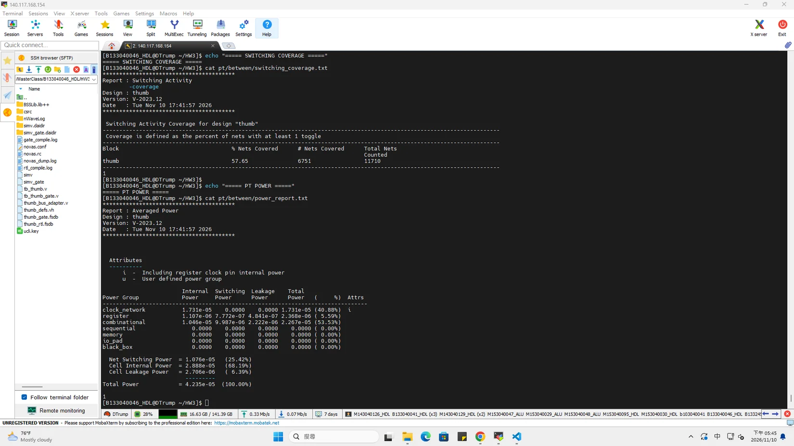

## 04 / APR 與 Setup / Hold

APR 流程使用 Innovus，包含 Floorplan、Placement、Clock Tree Synthesis、Routing 與 Timing Optimization。最終 Post-Route Timing Report 記錄：

| 指標 | 最終 APR 結果 |
| --- | --- |
| Setup WNS | **+0.780 ns** |
| Hold WNS | **+0.007 ns** |
| Setup / Hold TNS | **0.000 ns** |
| Violating Paths | **0** |

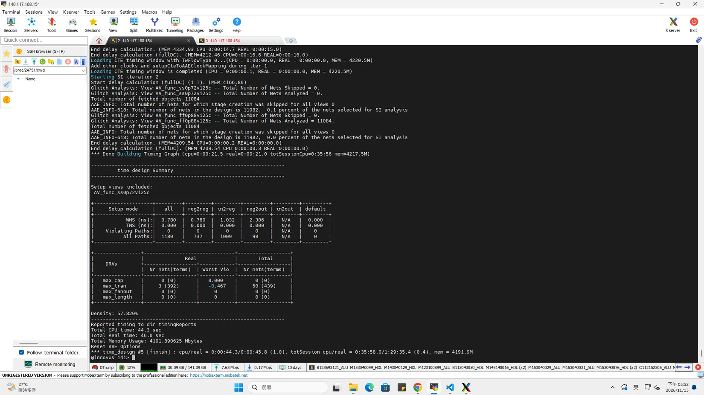

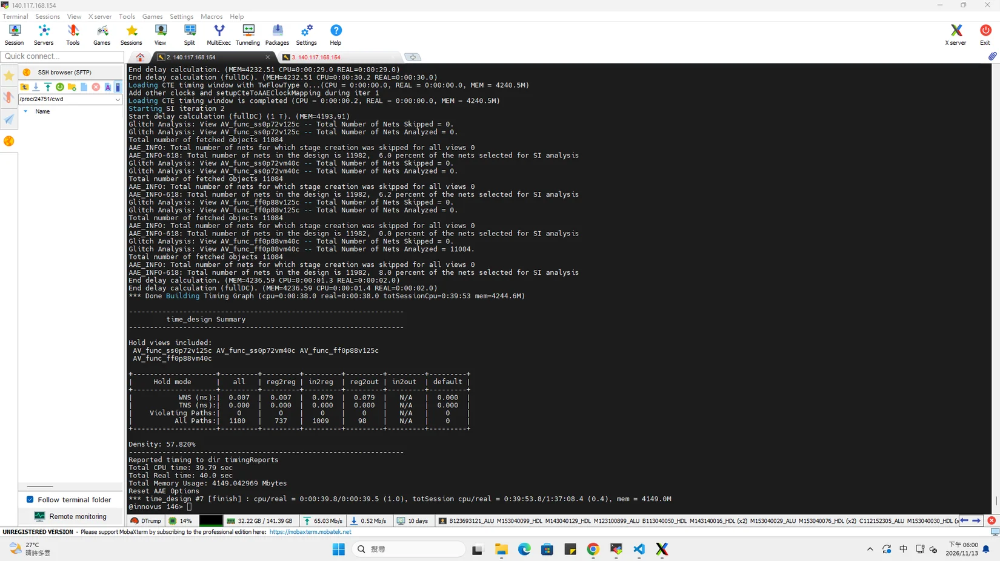

這次學到要區分 **Setup** 與 **Hold** 的檢查意義，並確認數值是在實體設計的哪個階段取得。

## 05 / DRC 與 LVS：最重要的排錯經驗

詳細繞線之後曾遇到 DRC Short，完成修正後，檢查結果為 **Verification Complete：0 Violations**。

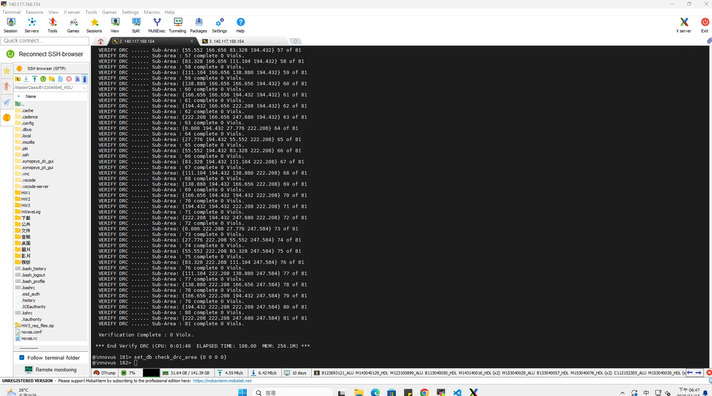

第一次 LVS 顯示 **INCORRECT**，原因是 Layout 中有 **6,593 顆 DCAP**，但 Source Netlist 中未對應到。後來根據更新的 `write_netlist.tcl` 調整 Physical Cell 的輸出方式，重新產生 PG Netlist、V2LVS 並執行 Calibre LVS，最後得到 **CORRECT**。

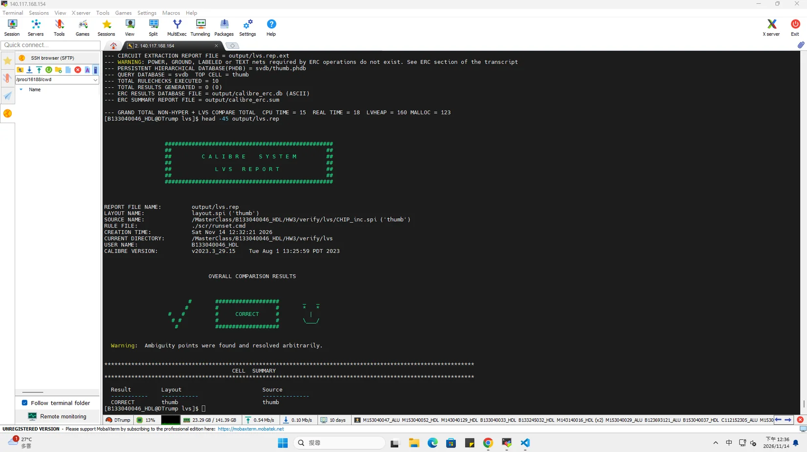

這段經驗讓我理解：LVS 不一致的來源可能是 Netlist 與 Physical-Only Cells 的對應問題，未必是 RTL 功能錯誤。

## 06 / Physical Layout 與 Module Highlight

下圖是完成 APR 後的 Layout 與四個 Pipeline Stage 的 Highlight。實體設計中的 Cell Placement 會依據走線、擁塞與 Timing 安排位置，因此 RTL 裡的四個邏輯模組，在 Layout 裡可能互相交錯。

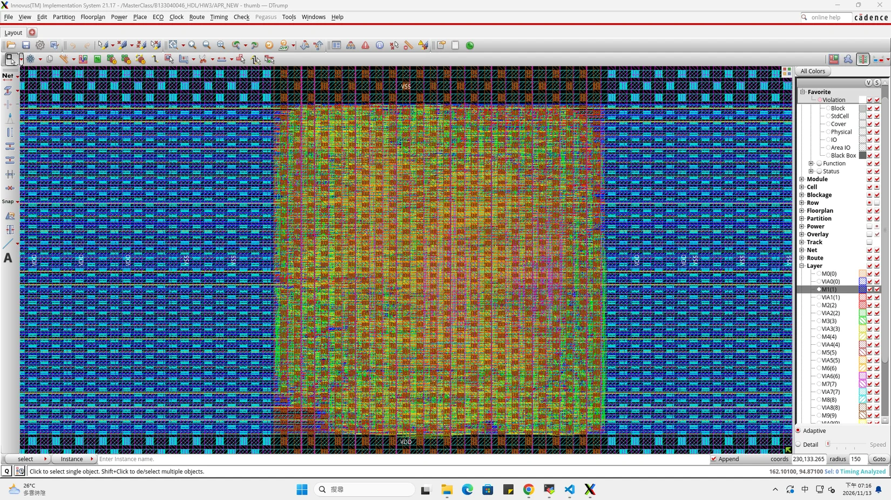

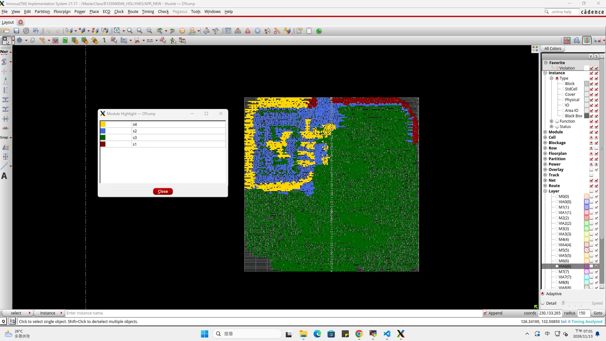

## 07 / 學習心得

這次真正將流程從 **RTL → Simulation → Synthesis → STA → APR → DRC / LVS** 串起來。功能模擬正確後，實體設計仍要完成繞線、時序與電路比對。HW3 最值得記下的是 LVS 修正：由報告內容追查 Physical Cell 與 Netlist 的差異，讓我第一次比較完整地理解 Signoff 階段在做什麼。

*資料來源：本人 HDL HW3 報告初稿，整理日期 2026-11-14。部分 DC/PT PPA 結果尚待同版核對；已完成的 APR、DRC、LVS 結果據該報告記錄。*
