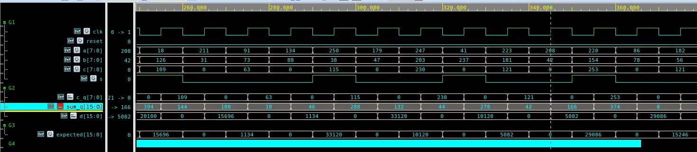

# Pipeline 與 Timing

> 以 HDL HW2、HW3 的實作經驗理解 Pipeline Stage、Latency 和 Throughput。

## 01 / 為什麼要分級？

一段長的組合邏輯需要等待運算結果一路傳播。Pipeline 在不同運算階段之間放入 **Stage Registers**，把工作拆成多個時脈週期，讓每級時序路徑較容易滿足目標 Clock Period。

## 02 / HW2 的兩級 Pipeline

第一級將 `a±b`、`c` 儲存到 `sum_q`、`c_q`，第二級在下一個 Clock Edge 進行乘法與輸出更新。測試時必須把輸出對應到**前面週期取樣的輸入**，這是寫 Testbench 最需要注意的地方。

## 03 / Latency 與 Throughput

**Latency** 是一筆資料從輸入到輸出的總延遲；**Throughput** 是單位時間內能完成多少筆。Pipeline 增加分級暫存器後，往往能提升穩態下的 Throughput，但單筆資料必須經過多個 Stage。

在 HW2 的報告定義中，兩級運算的 Stage Delay 為 `T1`、`T2`，記錄的比較方式為 `Critical Delay = max(T1, T2)`、`Latency = T1 + T2`（該作業的延遲計算模型）。實際處理器的時脈週期和完整端到端 Latency 仍需考慮暫存器、Clock 與邊界時序等因素。

## 04 / HW3 的四級 CPU

THUMB CPU 使用 **IF → ID → EX → WB** 四級 Pipeline。這讓各 Stage 能獨立分析路徑，也需要在 RTL 與波形中維持正確的控制與資料傳遞。

## 05 / 我的重點整理

設計 Pipeline 要同時考慮 **Stage 切割、資料對齊、Register 開銷、Latency 與 Timing**；比較效能不能只看單一 Critical Path 數字。

*資料來源：本人 HW2、HW3 作業報告。*
